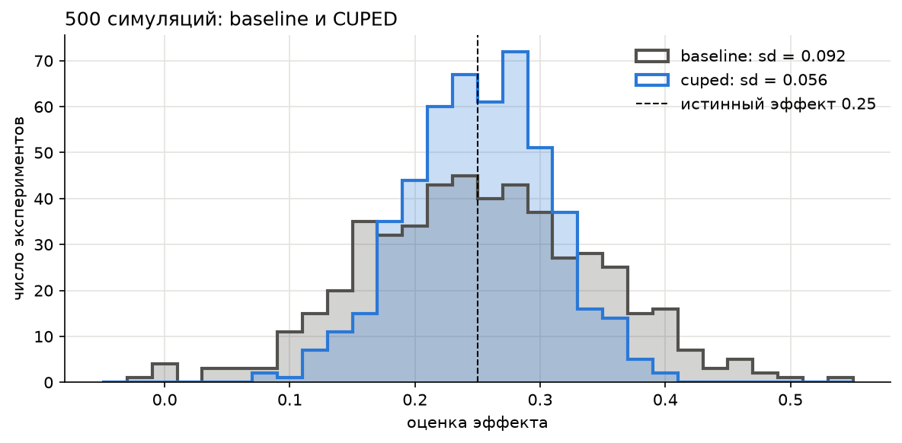
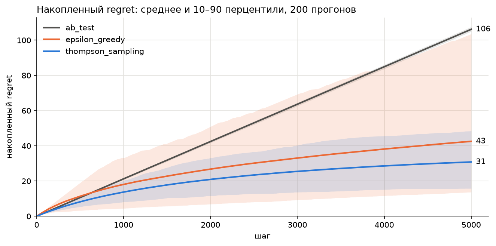

# A/B-тестирование: CUPED, стратификация и многорукие бандиты

Реализация трёх методов анализа A/B-тестов на Python с проверкой симуляцией.

| Метод | Задача | Результат |
|---|---|---|
| [CUPED](notebooks/01_cuped.ipynb) | Снизить дисперсию метрики с помощью данных до эксперимента | SE −38%, нужно в 2.6 раза меньше пользователей, мощность 79% → 99.6% |
| [Стратификация](notebooks/02_stratification.ipynb) | Оценить эффект с учётом сегментов пользователей | 95% ДИ уже на 21%, нужно в 1.6 раза меньше пользователей |
| [Многорукие бандиты](notebooks/03_bandits.ipynb) | Сравнить epsilon-greedy, Thompson Sampling и A/B-тест | Regret: 31 у Thompson Sampling, 43 у epsilon-greedy, 106 у A/B-теста |





## Что сделано

- **CUPED:** вручную посчитаны θ, CUPED-метрика, SE, 95% ДИ и p-value. Показано, почему `post_activity` нельзя брать ковариатой: оценка −0.22 при истинном эффекте 0.25.
- **Стратификация:** naive- и stratified-оценки, таблица по сегментам, сравнение доверительных интервалов.
- **Бандиты:** epsilon-greedy, Thompson Sampling и A/B-тест на 200 прогонах по 5 000 шагов.
- Для CUPED и стратификации проведено по 500 симуляций: мощность и покрытие 95% ДИ.

## Запуск

```bash
pip install -r requirements.txt
jupyter notebook
```

## Стек

Python, NumPy, pandas, SciPy, Matplotlib, Jupyter.

Данные синтетические, сгенерированы для симуляции экспериментов.

Автор: Владислав Беляев
